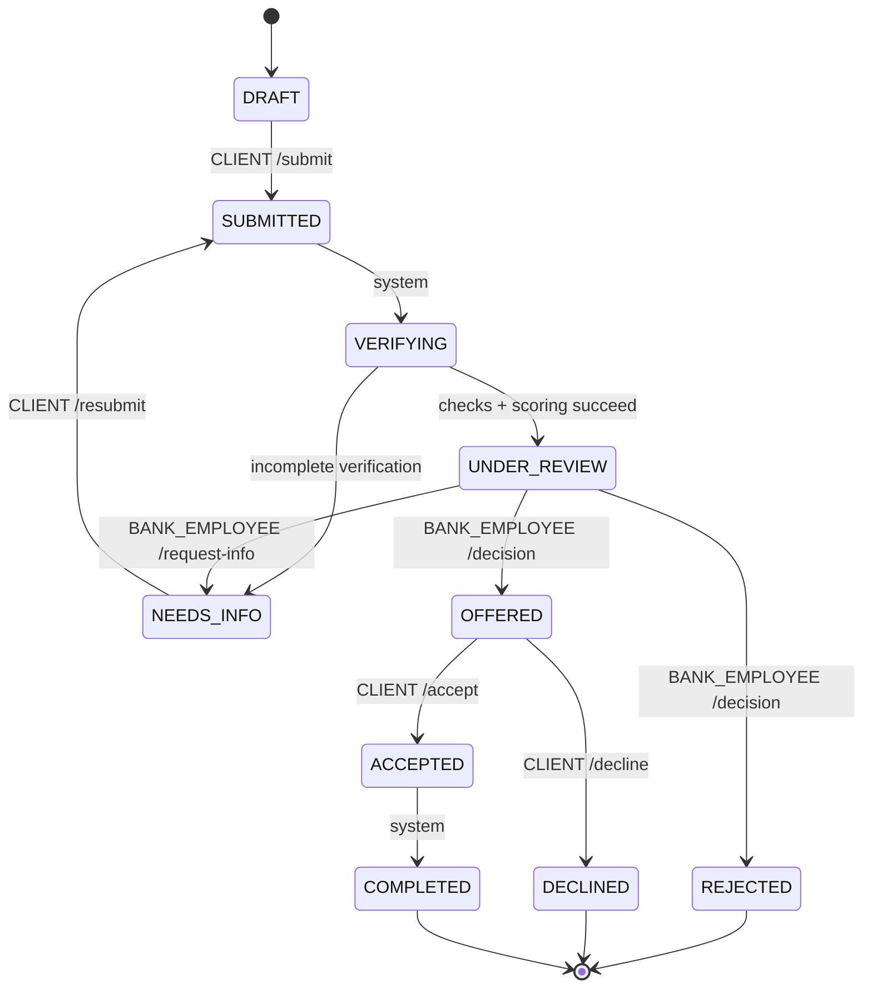

# Workflow заявки (VK-03 / VK-05)

**Инварианты:**

1. Все переходы проверяются централизованно в `transition()`. Каждый переход создаёт `ApplicationEvent` в той же транзакции, что и изменение статуса; системный актор `NULL`.
2. `POST /submit` только из DRAFT, `POST /resubmit` только из NEEDS_INFO при открытом запросе, `POST /decision` только из UNDER_REVIEW, принятие/отклонение только из OFFERED.
3. Банковский OFFERED/REJECTED возможен только при наличии актуального RiskAssessment и обеих успешных проверок для текущего `version`.
4. После первой подачи исходная `requested_amount`, `term_months`, `product_id` остаются неизменными. Сумма/срок/ставка предложений хранятся только в `credit_decisions`.
5. `/resubmit` увеличивает `version`; `verification_results` и `risk_assessments` новые, прежние версии сохраняются. `financial_snapshot` заявки отражает последнюю подачу; RiskAssessment.input_snapshot сохраняет данные каждой попытки.
6. Повторный submit/decision/accept/decline возвращает 409 и не добавляет новые решения и переходы.
7. В одном серверном обработчике вызывается один `commit()` после всех изменений. В PostgreSQL изменение статуса блокирует запись заявки через `FOR UPDATE`.
8. На основной демо-ветке обработка проверок синхронная: история сохраняет все промежуточные статусы даже при немедленном возврате UNDER_REVIEW.

**Не решается этим backend:** настоящая выдача денег и банковские проверки. Статус COMPLETED означает только симуляцию.
