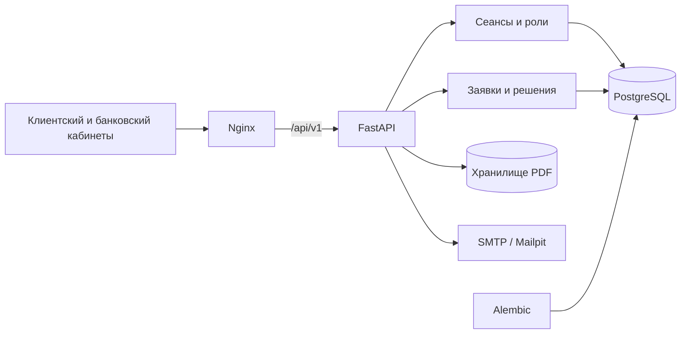

# Архитектура ФинМаршрут

Платформа кредитования бизнеса: React + TypeScript + Vite + Mantine, FastAPI и PostgreSQL.

## Запуск и хранение

Порядок запуска: PostgreSQL → миграции → каталог → API → frontend. PostgreSQL доступен только во внутренней сети Compose. Постоянные тома: pgdata для БД, documents для PDF, maildata для локальной почты.

Обычная загрузка создаёт каталог и публикации. Пользователи регистрируются или принимают приглашение; первый администратор создаётся серверной командой.

## Авторизация

HttpOnly cookie содержит непрозрачный идентификатор сеанса. В БД хранится его хеш; команды требуют CSRF. Смена пароля и блокировка сотрудника отзывают сеансы.

CLIENT видит собственную компанию и заявки. BANK_OFFICER и совместимая роль BANK_EMPLOYEE рассматривают заявки. BANK_ADMIN управляет сотрудниками и назначениями, но не принимает кредитные решения.

## Кредитный процесс

Компания → черновик → отправка → проверки → рассмотрение. Назначенный сотрудник запрашивает уточнения, одобряет исходные сумму и срок, предлагает другие условия либо отказывает. Клиент подтверждает предложение и завершает оформление.

SQL-транзакции и блокировки строк защищают решения и назначения от конкурирующих команд. Финансовый снимок отправленной заявки сохраняется независимо от последующих изменений профиля компании. PDF выдаётся после проверки прав.

## Интерфейс и помощник

Обе темы используют IBM Plex Sans и общую геометрию. Бренд задаётся в frontend/shared/brand.ts. Expandable Icon Rail обеспечивает навигацию; Hybrid AI Assistant 2.0 читает актуальные данные API и показывает источники.

Внешний реестр, БКИ, платёжная выдача и внешний LLM не подключены. Их отсутствие явно отражается в интерфейсе и результатах проверок.

Контракты: [API](../backend/docs/api_contract.md). Модель хранения: [БД](../backend/docs/data-model.md). Требования и макеты находятся в docs/specs и docs/frontend-reference.
