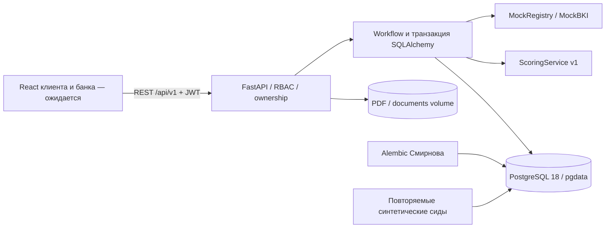

# Архитектура демонстрационного кредитного кабинета

Один модульный монолит FastAPI. Проверки и скоринг вызываются синхронно локальными Python-модулями без сетевых сервисов и платных API. Решение принимает сотрудник; высокий риск не означает автоматического отказа.



## Порядок запуска

`db healthy → migrate успешно → seed успешно → api healthy`. Healthcheck API проверяет HTTP, доступность таблицы версий Alembic и сид сотрудника. Веб-порт привязан к localhost, PostgreSQL остаётся во внутренней сети Compose. Тестовый сервис создаёт собственные схемы `test_credit_<uuid>` и удаляет только их; таблицы демонстрации в public не пересоздаются тестами.

```mermaid
sequenceDiagram
    actor Client as Клиент
    participant API as API и workflow
    participant Checks as Реестр и БКИ
    participant Score as ScoringService
    participant DB as PostgreSQL
    actor Bank as Сотрудник
    Client->>API: submit
    API->>DB: Блокировка заявки; SUBMITTED → VERIFYING
    API->>Checks: check(ИНН, название) / check(ИНН)
    Checks-->>API: Результаты и passed
    alt Данные подтверждены
        API->>Score: evaluate(snapshot, registry, bki, terms)
        Score-->>API: Балл, риск, факторы, версия, рекомендация
        API->>DB: Снимок, проверки, риск, UNDER_REVIEW, события; commit
    else Неизвестные или несогласованные данные
        API->>DB: Проверки, запрос уточнения, NEEDS_INFO, события; commit
    end
    Bank->>API: request-info / decision
    API->>DB: Блокировка; решение и переход с историей; commit
    Client->>API: accept / decline / resubmit
    API->>DB: Переход с историей; новая попытка при resubmit
```

## Ответственность и оставшиеся работы

Смирнов владеет схемой и миграциями, а также frontend. Вахрушев владеет HTTP-контрактом, правами и переходами. Волосников владеет модулями риска, Compose и проверкой общего запуска. Подключение UI и браузерная регрессия выполняются после поступления frontend в репозиторий. Секреты остаются в локальном `.env`; никакие реальные сведения клиентов не используются.
